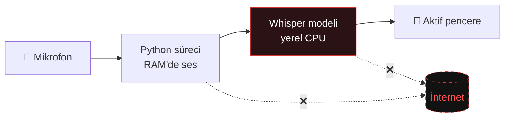

<div align="center">

# 🎙️ Türkçe Sesli Yazma

### Konuş, yazsın. Sesin bilgisayarından dışarı çıkmasın.

**Windows 11 için %100 offline, %100 açık kaynak Türkçe sesli yazma aracı.**
<br>
`Win + H`'ye bas, konuş, metin imlecin olduğu yere yazılsın. Bulut yok, hesap yok, telemetri yok.

<br>


</div>

---

## 🔒 Asıl mesele: sesin sende kalıyor

Windows'un kendi sesli yazması (`Win + H`), telefonundaki klavye, tarayıcı eklentileri… Neredeyse hepsi sesini **bir sunucuya gönderiyor**, orada metne çeviriyor ve geri yolluyor. Yani söylediğin her cümle başka birinin bilgisayarından geçiyor.

**Bu proje öyle çalışmıyor.**

| | Bulut tabanlı sesli yazma | **Türkçe Sesli Yazma** |
|---|:---:|:---:|
| Ses nerede işleniyor? | Uzak sunucuda | 🖥️ **Senin işlemcinde** |
| İnternet gerekiyor mu? | Her seferinde | ❌ **Hayır** (yalnızca ilk kurulumda) |
| Hesap / giriş | Çoğunlukla gerekli | ❌ **Yok** |
| Telemetri / kayıt | Var | ❌ **Yok** |
| Windows konuşma servisleri | Kullanılıyor | ❌ **Hiç dokunulmuyor** |
| Kaynak kodu | Kapalı | ✅ **Açık, tek dosya, okunabilir** |



- 🧠 **Ses tanıma tamamen yerelde** yapılıyor: OpenAI'nin açık kaynak [Whisper](https://github.com/openai/whisper) modeli, [faster-whisper](https://github.com/SYSTRAN/faster-whisper) ile CPU üzerinde çalışıyor.
- 🚫 **Uygulama ağa hiç çıkmıyor.** Model indirildikten sonra kod `HF_HUB_OFFLINE=1` ve `HF_HUB_DISABLE_TELEMETRY=1` ile kilitleniyor. İnternet kablosunu çekip dene, aynen çalışıyor.
- 💾 **Ses diske yazılmıyor.** Kayıt yalnızca RAM'de tutuluyor, metne çevrildikten sonra atılıyor.
- 🛡️ **Windows'a dokunmuyor.** SpeechRuntime, ctfmon gibi servislere ihtiyaç duymuyor. O&O ShutUp10 gibi araçlarla sıkılaştırılmış sistemlerde de sorunsuz çalışıyor.
- 🔍 **Doğrulanabilir.** Bütün uygulama tek bir [`dictation.pyw`](dictation.pyw) dosyası. Satır satır okuyup ne yaptığını kendin görebilirsin.

---

## ⚡ Kurulum: tek adım

> Sıfırdan kurulmuş bir Windows 11 bile olur. **Python dahil her şeyi kurulum betiği kendisi kuruyor.**

### Seçenek 1: Tek satır (önerilen)

`Win + R` → `powershell` → aşağıdakini yapıştır, Enter:

```powershell
irm https://raw.githubusercontent.com/osmnabyram/TextToSpeech-Turkce/main/install.ps1 | iex
```

### Seçenek 2: İndir, çift tıkla

1. Sağ üstteki **Code → Download ZIP** ile indir, bir klasöre çıkar.
2. **`install.bat`** dosyasına çift tıkla.

### Kurulum ne yapıyor?

```
① Python 3.12 yoksa python.org'dan indiriyor, dijital imzasını doğruluyor, sessizce kuruyor
② %LOCALAPPDATA%\TurkceSesliYazma içinde izole bir sanal ortam (venv) açıyor
③ Gerekli açık kaynak paketleri kuruyor
④ Whisper modelini BİR KEZ indiriyor (~500 MB)   ← internetin kullanıldığı son an
⑤ Bilgisayar açılışında otomatik başlaması için Başlangıç klasörüne kısayol ekliyor
⑥ Uygulamayı arka planda başlatıyor
```

Yönetici izni gerekmiyor. Kurulum bittikten sonra internete bir daha ihtiyacın olmuyor.

---

## 🎯 Kullanım

| Tuş | Ne yapar |
|---|---|
| `Win + H` | Dinlemeyi başlatır. Konuştukça metin panelde canlı olarak belirir |
| `Win + H` (tekrar) | Durdurur ve metni imlecin olduğu yere yapıştırır |
| `Esc` | İptal eder, hiçbir şey yazmaz |

Word, tarayıcı, Discord, VS Code, Not Defteri… İmlecin yanıp söndüğü her yerde çalışıyor.

- 🪟 Windows'un kendi `Win + H` paneline benzeyen, küçük, her zaman üstte duran kırmızı-siyah bir panel
- 📊 Canlı ses seviyesi göstergesi
- 🔴 Sistem tepsisinde (saatin yanında) simge, oradan çıkış yapılabiliyor
- 🔁 Bilgisayar her açıldığında sessizce kendiliğinden başlıyor, görev çubuğunu kalabalıklaştırmıyor
- 🧷 Tek kopya kilidi: yanlışlıkla iki kez açılmıyor

---

## ⚙️ Ayarlar

`%LOCALAPPDATA%\TurkceSesliYazma\dictation.pyw` dosyasının en üstündeki değerleri değiştirebilirsin:

| Ayar | Varsayılan | Açıklama |
|---|---|---|
| `MODEL_SIZE` | `"small"` | `base` daha hızlı, `medium` daha isabetli ama daha yavaş |
| `LANGUAGE` | `"tr"` | Tanınacak dil |
| `BEAM_SIZE` | `5` | Yüksek değer daha isabetli, daha yavaş |
| `CHUNK_SECONDS` | `3` | Canlı metnin kaç saniyede bir güncelleneceği |
| `INITIAL_PROMPT` | Türkçe örnek cümle | Noktalama ve yazım stilini yönlendirir |

> Model boyutunu değiştirdiysen yeni modeli indirmek için `install.bat`'ı bir kez daha çalıştır.

---

## 🧩 Kullanılan açık kaynak bileşenler

| Paket | Görev | Lisans |
|---|---|---|
| [faster-whisper](https://github.com/SYSTRAN/faster-whisper) | Yerel ses tanıma motoru | MIT |
| [Whisper modelleri](https://github.com/openai/whisper) | Konuşma tanıma modeli | MIT |
| [sounddevice](https://github.com/spatialaudio/python-sounddevice) | Mikrofon erişimi | MIT |
| [keyboard](https://github.com/boppreh/keyboard) | `Win + H` kısayolunu yakalama | MIT |
| [NumPy](https://numpy.org) | Ses verisi işleme | BSD |
| [pystray](https://github.com/moses-palmer/pystray) | Sistem tepsisi simgesi | LGPL |
| [Pillow](https://python-pillow.org) | Tepsi simgesini çizme | MIT-CMU |
| Tkinter | Yüzen panel arayüzü | PSF |

---

## 🧹 Kaldırma

`uninstall.bat`'a çift tıkla. Uygulama klasörü ve başlangıç kısayolu siliniyor; istersen indirilen ses modelleri de. Python yerinde bırakılıyor.

---

## 💻 Gereksinimler

- Windows 11 (Windows 10'da da çalışması beklenir)
- Mikrofon
- ~1.5 GB boş disk (Python + paketler + model)
- Ekran kartı **gerekmiyor**. Sıradan bir dizüstü işlemcisinde (ör. i5-1135G7) rahat çalışıyor

---

## 📄 Lisans

[MIT](LICENSE). İstediğin gibi kullan, değiştir, paylaş.

<div align="center">
<br>

**Sesin, senin verin. Öyle kalmalı.** 🔒

</div>
